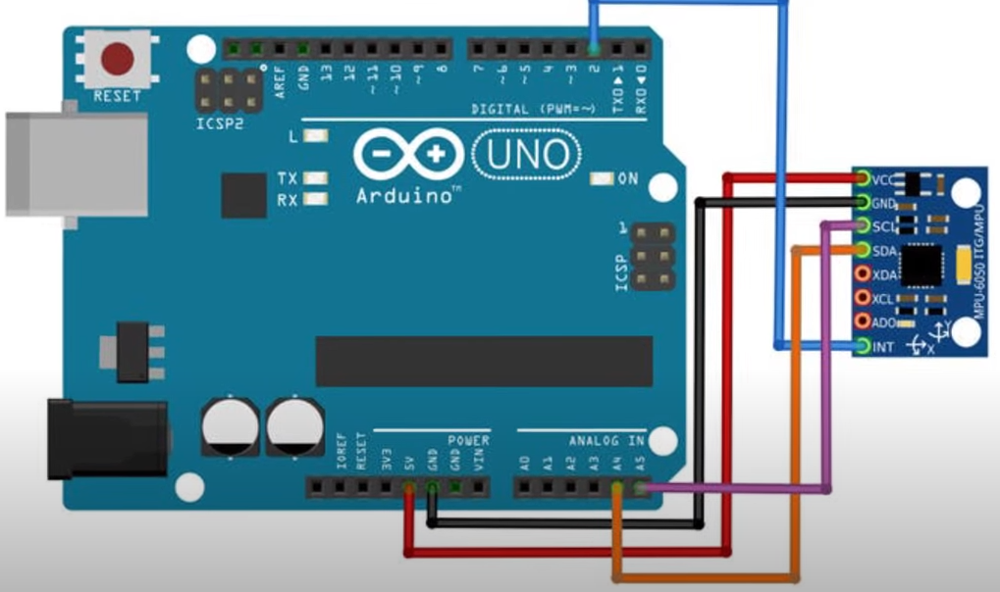
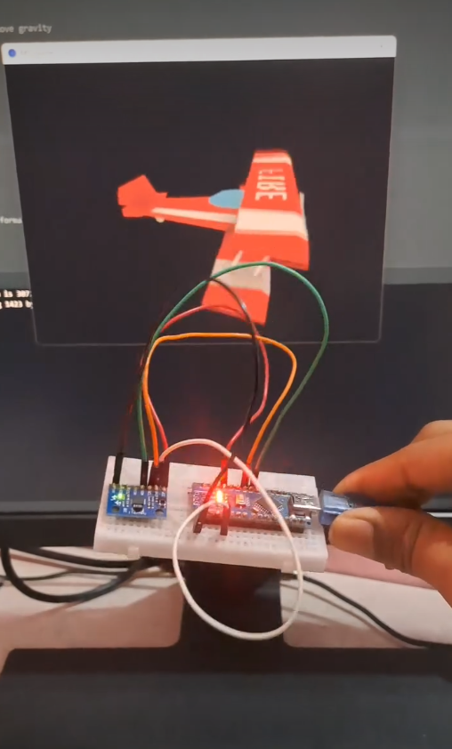

# MPU6050 3D Visualization

MPU6050 - Accelerometer and Gyroscope with Arduino and Processing IDE for 3D visualization. 
This project reads 6-axis motion tracking data from the MPU6050 sensor module using an Arduino and visualizes its 3D orientation in real-time using the Processing IDE.

## 📸 Demo & Screenshots

  
  
<i>Circuit Diagram / Connection Setup</i>

  
  
<i>3D Visualization Output in Processing IDE</i>

**Watch the Demo Video:**
* [YouTube Shorts](https://youtube.com/shorts/l07aA6tn2og)
* [Instagram Reel](https://www.instagram.com/reel/C1wiwcEJd7o/)

## 🛠️ Prerequisites

### Hardware
* Arduino Board (e.g., Uno, Nano)
* MPU6050 Sensor Module
* Jumper Wires

### Software
* [Arduino IDE](https://www.arduino.cc/en/software)
* [Processing IDE](https://www.processing.org/download/)

## ⚙️ Installation & Setup

### 1. Arduino Setup
1. Open the Arduino IDE.
2. Install the required `MPU6050` library:
   * It requires the [MPU6050 library by Jeff Rowberg](https://www.github.com/jrowberg/i2cdevlib/tree/master/Arduino/MPU6050).
   * Install it into your Arduino `libraries` folder or via the Library Manager if available.
3. Wire the MPU6050 to your Arduino (VCC to 5V/3.3V, GND to GND, SCL to SCL/A5, SDA to SDA/A4).
4. Upload the corresponding Arduino sketch to your board.

### 2. Processing Setup
1. Install [Processing IDE](https://www.processing.org/download/).
2. Install the `Toxiclibs` library for 3D rendering in Processing:
   * Download the library from [HERE](https://www.toxiclibs.org/downloads).
   * Extract the downloaded archive.
   * Move the extracted folder into your Processing libraries directory:
     * **Windows:** `[userdir]/Documents/Processing/libraries`
     * **Mac/Linux:** `~/Documents/Processing/libraries`
3. Open the Processing sketch (.pde) included in this project.
4. Make sure to update the COM port in the Processing code to match the port your Arduino is connected to.
5. Run the sketch to start the 3D visualization!
